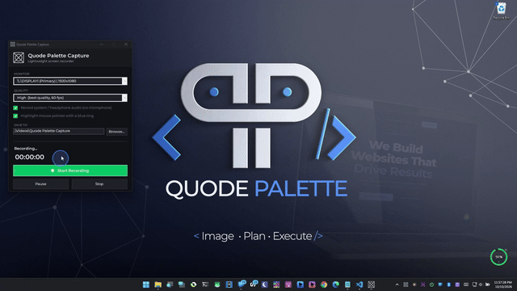

# Quode Palette Capture

A small, no-nonsense screen recorder for Windows. It records your screen and whatever you're hearing, and that's it. No webcam, no microphone, no flicker, and the audio stays in sync with the video.

I built it because I wanted something simple that just works, without a pile of settings or a giant installer.

<p align="center">
  
</p>

## What it does

- Records any monitor to a standard `.mp4`
- Captures system audio (speakers, wired headphones, Bluetooth, whatever Windows is playing)
- Optional blue ring around your mouse pointer, so viewers can follow where you are
- Pause, resume and stop whenever you like
- Three quality presets: Low (30 fps, smaller files), Medium (30 fps, balanced) and High (60 fps, best quality)
- Lives in the system tray so a stray click can't end your recording
- Dark UI with Montserrat built in, so it looks the same on every PC

## What it deliberately doesn't do

It never touches your microphone or camera. Those code paths don't exist in the app, so there's nothing to turn off. The audio option only records your playback device.

## Why it doesn't flicker or drift

- **No tearing or flicker:** frames come from the Windows Graphics Capture API, the same GPU pipeline Windows itself uses, instead of polling the screen with GDI.
- **Real-speed video:** every frame is timestamped by the capture API, so the video can't slide into slow motion or fast-forward.
- **Audio in sync:** audio and video are written against one shared clock as they're captured, not stitched together afterwards.
- **Light on your PC:** it uses hardware H.264 encoding through Media Foundation when your GPU supports it.

Under the hood this is a WinForms app built on [ScreenRecorderLib](https://www.nuget.org/packages/ScreenRecorderLib) (pinned to 6.6.0).

## Build it

You'll need:

- Windows 10 (1903 / build 18362) or newer, or Windows 11
- The [.NET 8 SDK](https://dotnet.microsoft.com/download/dotnet/8.0)
- An internet connection for the first build, so NuGet can grab the recording library

Then:

1. Clone or download this repo.
2. Double-click `build.bat`.
3. Grab the whole `dist` folder and run `Quode Palette Capture.exe` from inside it.

Keep the whole folder together, not just the exe. ScreenRecorderLib is a mixed-mode native and managed library, and .NET's single-file publish corrupts those, so the app ships as a folder instead.

The build is self-contained, so you only need the .NET SDK on the machine that builds it. Whoever runs the app doesn't need .NET installed.

Prefer the command line?

```
dotnet publish -c Release -r win-x64 --self-contained true -p:Platform=x64 -o dist
```

## Using it

1. Pick a monitor, a quality preset, and whether to record system audio.
2. Choose whether you want the blue pointer ring (it's on by default).
3. Change the save folder if you want (default is `Videos\Quode Palette Capture`).
4. Hit **Start Recording**. Use **Pause** and **Resume** as needed, then **Stop**.
5. Files are saved as `QuodePaletteCapture_yyyyMMdd_HHmmss.mp4`.

Heads up: clicking the window's X sends the app to the tray instead of closing it. That's on purpose, so you can't kill a recording by accident. Right-click the tray icon for the same controls, or choose **Exit** there to fully quit.

## Troubleshooting

- **Package restore failed:** you need internet for the first build. After that the package is cached.
- **Recording won't start:** usually a graphics driver problem. Update your GPU driver. If hardware encoding isn't available, the app still works with a bit more CPU load.
- **Black screen in the recording:** this happens with DRM-protected video or over Remote Desktop. Record the physical screen locally instead.
- **Something crashed:** the app shows the error and also writes details to `QuodePaletteCapture_error.log` next to the exe.

## Project layout

```
QuodePaletteCapture.csproj   Project file and ScreenRecorderLib reference
Program.cs                   Entry point, single-instance check, error handling
MainForm.cs                  UI, tray icon and recording logic
CursorHighlight.cs           The blue ring that follows your pointer
AppFonts.cs                  Loads the embedded Montserrat fonts
AppTheme.cs                  Dark theme, title bar and tray menu
Fonts/                       Montserrat .ttf files
AppIcon.ico / .png           App icon
build.bat                    One-click build, outputs to dist\
```
