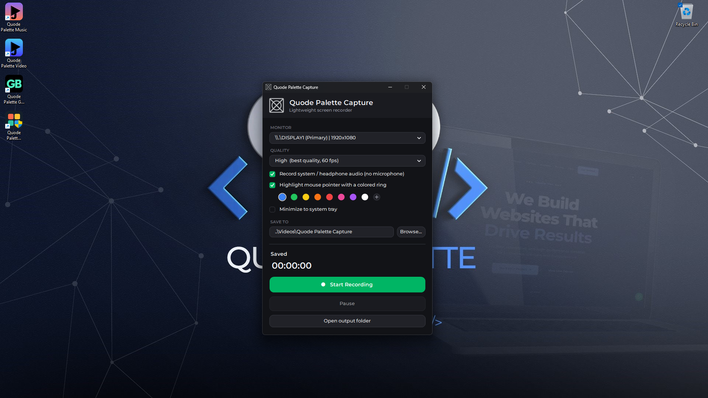
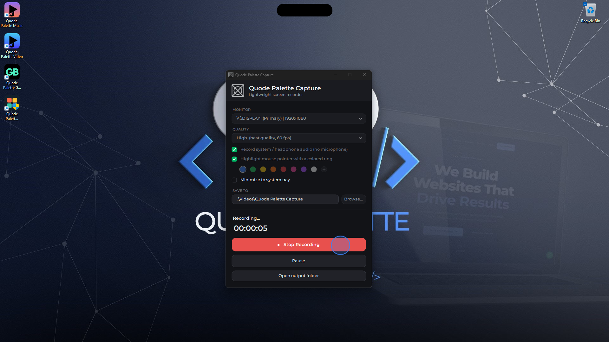
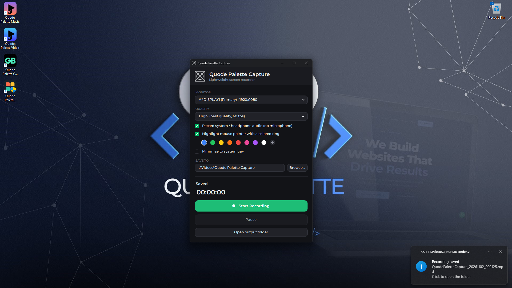

# Quode Palette Capture

A lightweight, dark-themed screen recorder for Windows. Pick a monitor, press **Start Recording**, and get a smooth MP4 with system audio and an optional colored ring around your mouse pointer. It ships as a single `.exe`, with no installer and nothing else to set up.

  

  

  

## Features

- **One-click recording** of any connected monitor, saved as H.264 / AAC `.mp4`.
- **Three quality presets**
  - **Low**: 30 fps, smaller files
  - **Medium**: 30 fps, balanced
  - **High**: 60 fps, best quality (default)
- **System audio capture**: records what you hear through your speakers or headphones, and follows whichever output device Windows is using (wired, Bluetooth, and so on). The microphone is not recorded.
- **Mouse pointer highlight**: a translucent colored ring follows your cursor so viewers can track it. Choose from 8 preset colors or open the color picker with **+** for any custom color. The ring appears in the video.
- **Floating timer pill**: an always-on-top elapsed-time display with a Stop button. It is excluded from screen capture, so it never appears in your recorded video.
- **Pause and Resume** without ending the file. The timer and the cursor ring pause with it.
- **System tray support** (optional): minimize or close to the tray and control recording from the tray menu: Start, Pause, Stop, Open output folder, Exit.
- **"Recording saved" notification** that opens the output folder when clicked.
- **Remembers your preferences**: tray behavior and highlight color are saved between runs.
- **Single instance**: launching a second copy tells you the app is already running.

## Troubleshooting

- **"Already running" message**: the app is open, possibly in the system tray. Right-click the tray icon and choose **Show Quode Palette Capture**.
- **No timer pill visible**: the pill only shows on Windows 10 2004 or newer, where it can be reliably excluded from capture. If that can't be confirmed, it stays hidden rather than risk appearing in your video.
- **No sound in the recording**: make sure *Record system / headphone audio* is checked and that something is actually playing through your default output device.
- **Windows SmartScreen warning on first run**: the exe is not code-signed. Choose **More info**, then **Run anyway**.

## Fonts

The font is under the SIL Open Font License.

## License

Released under the [PolyForm Noncommercial License 1.0.0](LICENSE). You are free to use, modify and share it for personal, educational and other noncommercial purposes. For commercial use, please get in touch.
[Email Us](mailto:hello@quodepalette.com)

